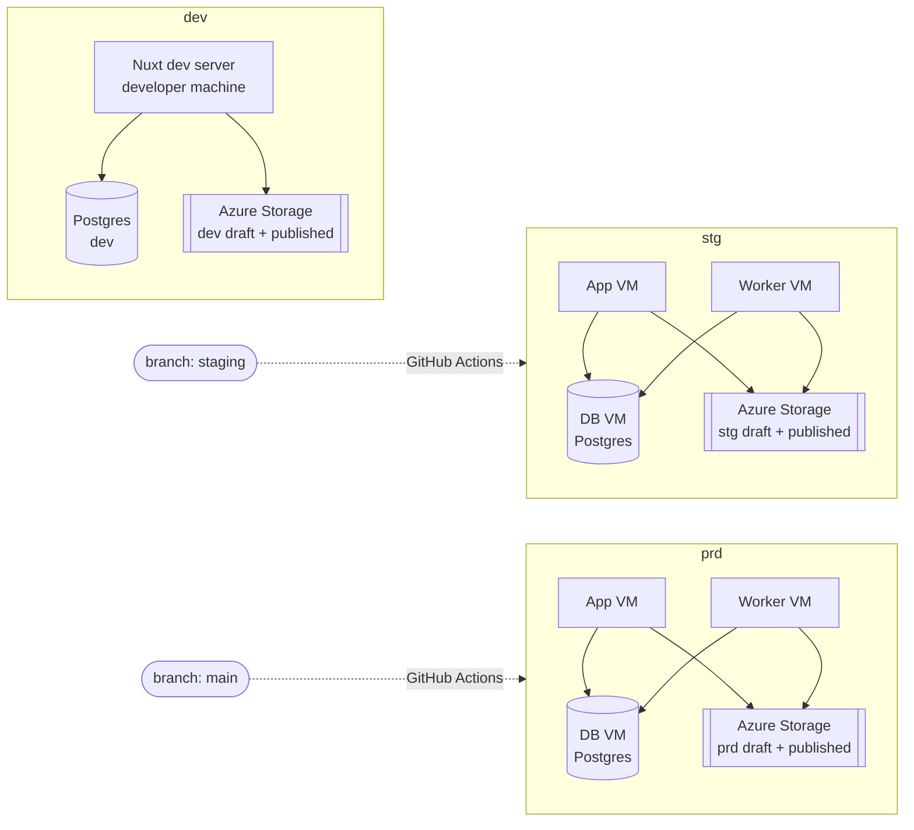
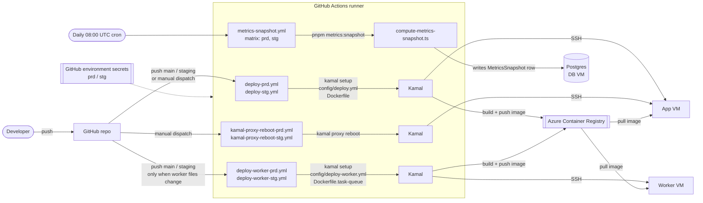
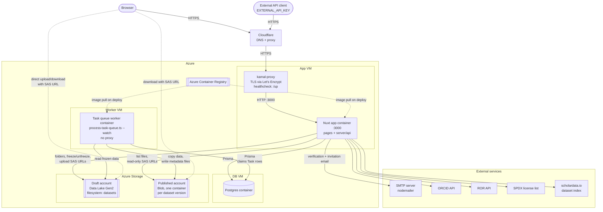
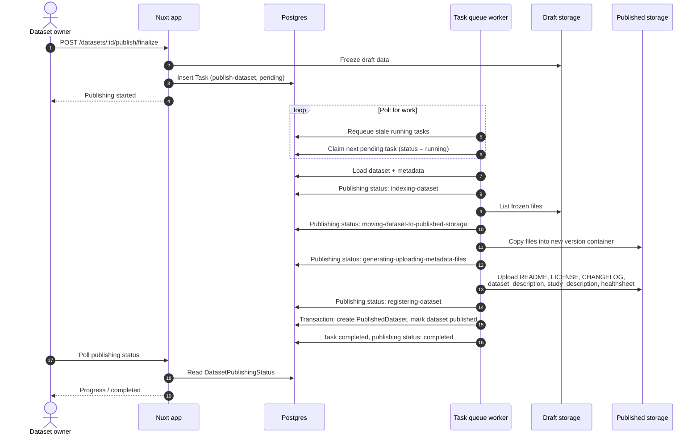
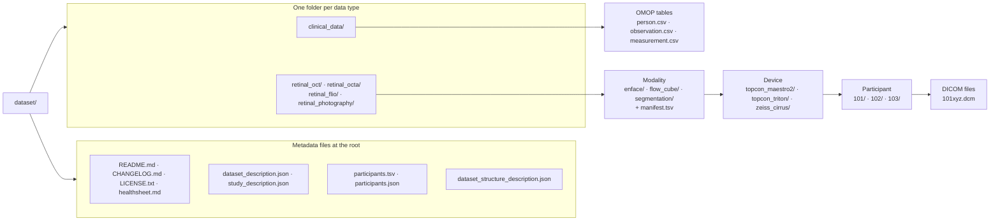
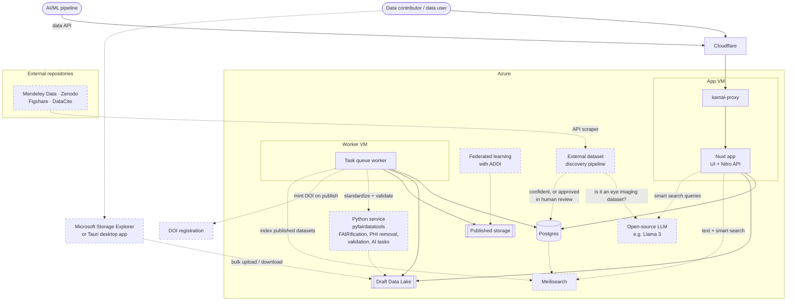
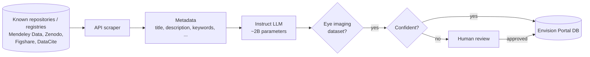

# Envision Portal architecture

Envision Portal is a Nuxt application deployed with [Kamal](https://kamal-deploy.org) to Azure VMs. GitHub Actions builds and deploys everything. A separate task-queue worker handles long-running dataset work, such as publishing.

- [Environments](#environments)
- [CI/CD pipeline](#cicd-pipeline)
- [Runtime topology](#runtime-topology)
- [Dataset publishing flow](#dataset-publishing-flow)
- [Published dataset layout](#published-dataset-layout)
- [Planned architecture](#planned-architecture)

The first four sections describe what is deployed today. The last section describes planned components that the code doesn't have yet.

## Environments

There are three environments. Each one has its own Postgres database and its own Azure Storage accounts, one for drafts and one for published data.

| Environment | App runs on                       | Deployed by                               | Git trigger       |
| ----------- | --------------------------------- | ----------------------------------------- | ----------------- |
| `dev`       | Developer machine (`pnpm dev`)    | Nobody; it runs locally                   | none              |
| `stg`       | Azure VMs (app, worker, database) | `deploy-stg.yml`, `deploy-worker-stg.yml` | push to `staging` |
| `prd`       | Azure VMs (app, worker, database) | `deploy-prd.yml`, `deploy-worker-prd.yml` | push to `main`    |

## CI/CD pipeline

Every deploy runs `kamal setup` from a GitHub Actions runner. Kamal builds the image for `amd64`, pushes it to Azure Container Registry, then connects to the target VM over SSH as `azureuser`, where the VM pulls the image and swaps containers. Secrets come from the GitHub environment (`prd` or `stg`) and reach the containers through `.kamal/secrets`.

## Runtime topology

This shows one deployed environment (`stg` and `prd` look the same). Cloudflare proxies traffic to `kamal-proxy`, which terminates TLS with a Let's Encrypt certificate and forwards to the Nuxt container on port 3000.

## Dataset publishing flow

The web app doesn't publish a dataset itself. It queues a `Task` row, and the worker on its own VM claims that row and runs it. The worker sends a heartbeat while it runs a task, and requeues any task whose heartbeat goes stale, so a worker restart doesn't lose work. Task types are `publish-dataset`, `rebuild-frozen-data` and `purge-draft`.

## Published dataset layout

Each published dataset version follows the Clinical Dataset Structure (CDS). Metadata files sit at the root, with one folder per data type. Clinical data is stored as OMOP CDM tables in CSV files. Each imaging data type is split by modality, then device, then participant, and the image files are DICOM.

## Planned architecture

In the diagram below, dashed boxes are planned and don't exist in the code yet; solid boxes are deployed today.

These are the planned additions to the current architecture:

| Component                                                      | Purpose                                                                     | Target             |
| -------------------------------------------------------------- | --------------------------------------------------------------------------- | ------------------ |
| Python service using `pyfairdatatools`                         | Standardizes data and metadata to the CDS; runs AI and bioinformatics tasks | 2026–27 onward     |
| Meilisearch, Community Edition                                 | Text search indexes for data discovery                                      | 2027–28            |
| Open-source LLM, such as Llama 3                               | Smart search, and classifying datasets found in external repositories       | 2026–27 onward     |
| External dataset discovery pipeline                            | Finds eye imaging datasets in other repositories and indexes them           | 2026–27            |
| DOI minting                                                    | Gives a DOI to each published dataset and version                           | 2025–27            |
| Microsoft Storage Explorer, later possibly a Tauri desktop app | Bulk data upload and download                                               | 2026–27, if needed |
| Public data API                                                | Lets AI/ML pipelines use datasets directly                                  | 2027–28            |
| Federated learning, with ADDI                                  | Model training without moving data                                          | 2026–29            |

Background tasks run in TypeScript (`scripts/process-task-queue.ts`), so the app and the worker share one language stack, along with the Prisma schema and server utilities. The original design called for these tasks to run as long-running Python apps.

### External dataset discovery pipeline

