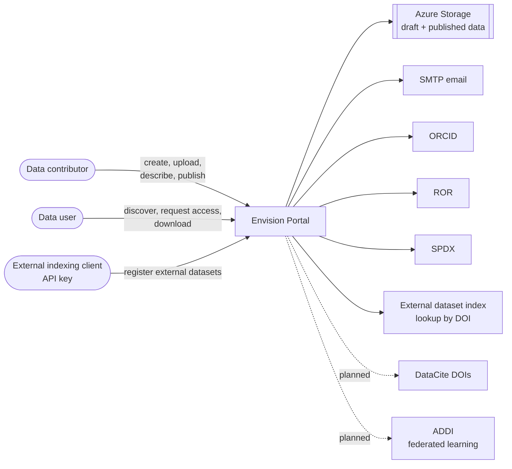
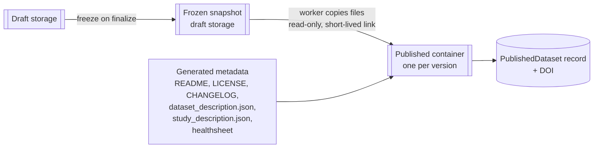
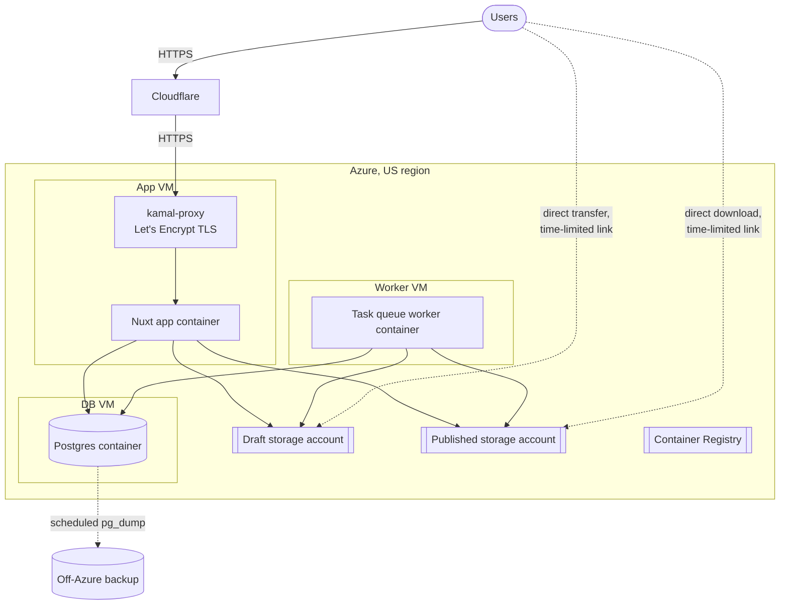
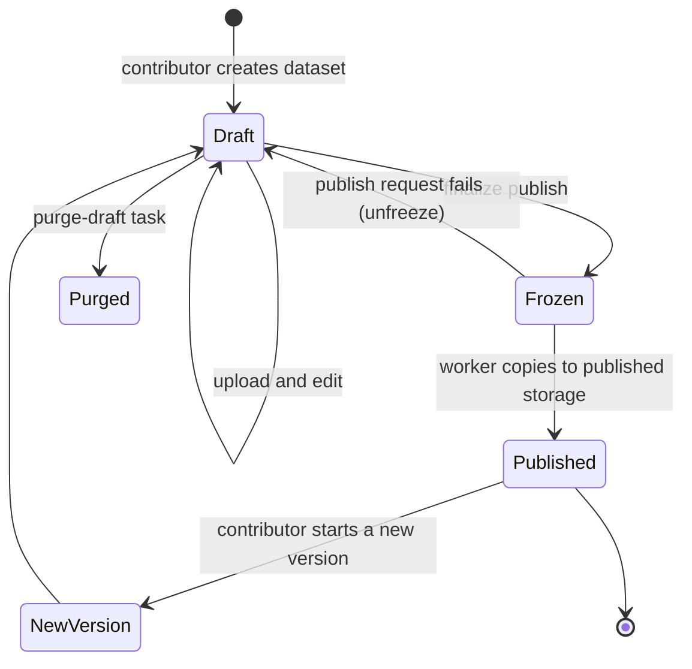

# Envision Portal: Solution Architecture Document

## 1. Introduction

### 1.1 Purpose

This document describes the architecture of the Envision Portal: its components, data, deployment, integrations and security controls. It covers the architecture deployed today and the target architecture through 2029, and it lists known gaps and risks with recommended actions.

### 1.2 System summary

The Envision Portal is a web platform where researchers share FAIR and AI-ready eye imaging datasets, and where others discover, request access to and download them. It also indexes eye imaging datasets hosted on other repositories. See the [Scope Definition](scope-definition.md) for goals, users and scope.

## 2. Architecture drivers

### 2.1 Key functional requirements

| ID   | Requirement                                                                                                             |
| ---- | ----------------------------------------------------------------------------------------------------------------------- |
| FR-1 | Users create accounts and verify their email address before signing in.                                                 |
| FR-2 | Contributors create datasets and invite collaborators with owner, admin, editor or viewer roles.                        |
| FR-3 | Contributors upload data directly to cloud storage, without routing files through the web server.                       |
| FR-4 | Contributors enter study and dataset metadata, README, license, changelog and Healthsheet.                              |
| FR-5 | Publishing freezes the draft, copies it to immutable published storage and generates metadata files.                    |
| FR-6 | Each published dataset is open or controlled; controlled access requires owner approval and signed data use agreements. |
| FR-7 | Each published dataset has a public landing page and a persistent identifier (DOI).                                     |
| FR-8 | External datasets can be registered in the portal's index.                                                              |
| FR-9 | Usage metrics are shown for each dataset and for the platform.                                                          |

### 2.2 Quality attributes (non-functional requirements)

| Attribute        | Requirement                                                              | Current state                                                                                                      |
| ---------------- | ------------------------------------------------------------------------ | ------------------------------------------------------------------------------------------------------------------ |
| Security         | Access to unpublished and controlled data is limited to authorized users | Role checks on every dataset API; time-limited, scoped storage links                                               |
| Privacy          | Participant data is shared only as consent and data sensitivity allow    | Open/controlled access levels; data classification is an open item                                                 |
| Integrity        | Published datasets cannot change after publication                       | Copied to a separate storage account, one container per version; storage immutability policies are not yet applied |
| Availability     | The portal is available for normal research use; no formal SLA           | Single VM per tier; no uptime monitoring yet                                                                       |
| Recoverability   | The database and data can be restored after loss                         | Scheduled `pg_dump` off-Azure; RPO/RTO not defined                                                                 |
| Scalability      | Large imaging files (GBs to TBs) transfer reliably                       | Direct-to-storage transfer; publishing runs in a background worker                                                 |
| Maintainability  | A small team can build and operate it                                    | One language stack (TypeScript), containerized, automated deploys                                                  |
| Transparency     | Open source, documented, standards-based                                 | Public GitHub repository, MIT license                                                                              |
| Interoperability | Datasets follow open standards                                           | CDS layout, DICOM imaging, OMOP clinical data, schema.org-aligned metadata                                         |

### 2.3 Constraints

- Microsoft Azure is the cloud provider (Azure credits from Microsoft AI for Good Lab).
- Open-source, MIT-compatible components only.
- Small team: favor managed services and one language stack where practical.
- Must align with NIH data sharing and security policies and CALMI2 institutional IT policy.

## 3. System context

## 4. Logical architecture

| Component           | Technology                                           | Responsibility                                                                                                        |
| ------------------- | ---------------------------------------------------- | --------------------------------------------------------------------------------------------------------------------- |
| Web application     | Nuxt 4, Vue 3, Nuxt UI, Tailwind                     | Server-rendered UI for contributors, data users and dataset owners                                                    |
| API                 | Nitro (inside Nuxt), zod validation                  | REST endpoints for auth, datasets, members, invitations, metadata, files, publishing, requests, discovery and metrics |
| Data access layer   | Prisma ORM                                           | All database access; schema in `prisma/schema.prisma`                                                                 |
| Task queue worker   | Node.js/TypeScript (`scripts/process-task-queue.ts`) | Long-running jobs claimed from a `Task` table: `publish-dataset`, `rebuild-frozen-data`, `purge-draft`                |
| Metrics job         | Scheduled GitHub Actions job                         | Daily precomputed usage metrics written to the database                                                               |
| Relational database | PostgreSQL                                           | Users, datasets, metadata, permissions, requests, tasks, published records                                            |
| Draft storage       | Azure Data Lake Storage Gen2                         | Contributors' working data, one folder per dataset                                                                    |
| Published storage   | Azure Blob Storage                                   | Published dataset versions, one container per version                                                                 |
| Reverse proxy       | kamal-proxy                                          | TLS termination, routing, health checks, zero-downtime container swaps                                                |
| Edge                | Cloudflare                                           | DNS and traffic proxy                                                                                                 |

### 4.1 Publishing pipeline

Published datasets follow the Clinical Dataset Structure (CDS). See [Published dataset layout](architecture.md#published-dataset-layout).

## 5. Deployment architecture

### 5.1 Environments

| Environment | Hosting              | Database               | Storage                       | Deployed from    |
| ----------- | -------------------- | ---------------------- | ----------------------------- | ---------------- |
| dev         | Developer machines   | Separate dev database  | Separate dev storage accounts | Local            |
| stg         | Azure VMs, US region | Postgres on its own VM | Separate stg storage accounts | `staging` branch |
| prd         | Azure VMs, US region | Postgres on its own VM | Separate prd storage accounts | `main` branch    |

Each environment has its own database, storage accounts and secrets. No data is shared between environments.

### 5.2 Production topology

### 5.3 Build and deployment

- GitHub Actions deploys on pushes to `staging` and `main`, or by manual dispatch.
- Kamal builds `amd64` images, pushes them to Azure Container Registry, and deploys over SSH with zero-downtime container swaps behind kamal-proxy.
- The worker is deployed separately, and only when worker-related files change.
- Deploy secrets are stored as GitHub environment secrets (`stg`, `prd`) and injected into containers at deploy time. We use Doppler to manage the integrations with github.

Full diagrams: [CI/CD pipeline](architecture.md#cicd-pipeline).

## 6. Data architecture

### 6.1 Data stores

| Store             | Contents                                                                                                                                                                                 | Encryption at rest                                    |
| ----------------- | ---------------------------------------------------------------------------------------------------------------------------------------------------------------------------------------- | ----------------------------------------------------- |
| PostgreSQL        | User accounts (email, name, bcrypt password hash), dataset metadata, memberships, access requests (requester name, email, affiliation, reason), data use agreement links, tasks, metrics | Azure managed-disk encryption (platform-managed keys) |
| Draft storage     | Contributor-uploaded files and frozen snapshots                                                                                                                                          | Azure Storage service encryption                      |
| Published storage | Published dataset versions and generated metadata                                                                                                                                        | Azure Storage service encryption                      |
| Off-Azure backups | `pg_dump` database exports                                                                                                                                                               | _To confirm_                                          |

### 6.2 Data classification

**Open item.** It has not been decided whether the platform stores de-identified data only, or a limited data set that may contain PHI (for example, dates) until automated de-identification tools exist. This decision determines which NIH and institutional controls apply and must be made before external contributors upload data. Until then, the recommended control is to require de-identified data in the terms of use and to review datasets before publication.

### 6.3 Data lifecycle

- Published versions are kept indefinitely so DOIs keep resolving.
- Draft data can be purged with a `purge-draft` task.
- Retention for accounts, access requests, logs and backups is not yet defined (see Section 11).

## 7. Integration architecture

| Integration            | Direction | Protocol / auth                                                             | Data exchanged                         |
| ---------------------- | --------- | --------------------------------------------------------------------------- | -------------------------------------- |
| Azure Storage          | Outbound  | HTTPS; account keys / connection strings server-side; SAS links for clients | Dataset files                          |
| SMTP provider          | Outbound  | SMTP with credentials                                                       | Verification and invitation emails     |
| ORCID public API       | Outbound  | HTTPS, public                                                               | Researcher identifiers and names       |
| ROR API                | Outbound  | HTTPS, public                                                               | Organization identifiers               |
| SPDX license list      | Outbound  | HTTPS, public                                                               | License identifiers and text           |
| External dataset index | Outbound  | HTTPS, public                                                               | Dataset index details looked up by DOI |
| External dataset API   | Inbound   | HTTPS, shared API key in `x-api-key` header                                 | External dataset metadata to register  |
| DataCite (planned)     | Outbound  | HTTPS, repository credentials                                               | DOI registration and metadata          |
| ADDI (planned)         | TBD       | TBD                                                                         | Federated learning                     |

## 8. Security architecture

### 8.1 Identity and authentication

- Email and password accounts. Passwords are at least 8 characters and stored as bcrypt hashes.
- Email verification is required before sign-in.
- Sessions use an encrypted, server-sealed session cookie (`nuxt-auth-utils`), with the sealing key held as a deployment secret.
- No single sign-on, multi-factor authentication, password reset or account lockout yet (see Section 11).

### 8.2 Authorization

- Every dataset API checks the caller's role on that dataset: viewer, editor, admin or owner, each including the rights of the roles below it.
- Datasets are locked while publishing, so they can't be edited mid-publish.
- Controlled datasets require an access request, owner approval and signed data use agreements from both the requester and the submitter.
- The inbound external dataset API rejects requests unless the `x-api-key` header matches the configured key.

### 8.3 Storage access

Users never get storage account keys. The server issues short-lived Shared Access Signature (SAS) links:

| Use                | Scope                           | Permissions                            | Lifetime                     |
| ------------------ | ------------------------------- | -------------------------------------- | ---------------------------- |
| Owner upload       | One dataset's draft folder      | Read, add, create, write, delete, list | 8 hours                      |
| Published download | One published version container | Read, list                             | 24 hours                     |
| Worker copy source | One frozen folder               | Read                                   | 24 hours, refreshed every 12 |

Storage account keys exist only in server-side environment variables.

### 8.4 Encryption

- **In transit:** HTTPS from users to Cloudflare and from Cloudflare to kamal-proxy (Let's Encrypt certificate). HTTPS to Azure Storage and external APIs. Encryption of the app/worker-to-Postgres connection is _to confirm_.
- **At rest:** Azure Storage service encryption and managed-disk encryption, both with platform-managed keys.

### 8.5 Secrets management

- Secrets (database URL, session key, storage keys, API key, registry credentials, SSH keys) are stored as GitHub environment secrets, separated by environment.
- Kamal injects them into containers at deploy time. They are not committed to the repository.

### 8.6 Network and infrastructure

- Public traffic enters through Cloudflare and kamal-proxy only. The app container listens only on the VM's internal Docker network.
- VM administration is SSH with key-only access, held by a small number of developers and GitHub Actions.

### 8.7 Logging and monitoring

- Containers log to standard output; request URLs are logged.
- kamal-proxy health-checks the app at `/up` during deploys.

### 8.8 Software supply chain

- The source is public (MIT license) and dependencies are pinned through a frozen lockfile.
- Container images are built from `node:22-alpine` in CI.

## 9. Operations

### 9.1 Backup and recovery

| Asset             | Backup                                                                                | Status                                                                         |
| ----------------- | ------------------------------------------------------------------------------------- | ------------------------------------------------------------------------------ |
| PostgreSQL        | Scheduled `pg_dump` to off-Azure storage                                              | In place; schedule, retention, encryption and restore testing to be documented |
| Draft storage     | None beyond Azure redundancy; soft delete and versioning not enabled (Data Lake Gen2) | Gap                                                                            |
| Published storage | None beyond Azure redundancy; soft delete and versioning not enabled (Data Lake Gen2) | Gap; published data is the long-term record                                    |
| Configuration     | Infrastructure config and Dockerfiles in Git; secrets in GitHub                       | In place                                                                       |

Recovery point (RPO) and recovery time (RTO) objectives are not yet defined.

### 9.2 Change management

All changes go through Git. Staging (`staging` branch) is deployed and checked before production (`main` branch). Deploys are automated and can be re-run or rolled back by redeploying an earlier commit.

### 9.3 Incident response

No incident response plan exists yet. It should cover security incidents, data exposure, and notification duties under NIH and CALMI2 policy.

## 10. Compliance alignment

| Framework                                              | How the architecture supports it                                                                                                   | Gaps                                                                                    |
| ------------------------------------------------------ | ---------------------------------------------------------------------------------------------------------------------------------- | --------------------------------------------------------------------------------------- |
| NIH Data Management and Sharing Policy                 | Persistent identifiers, rich standardized metadata, open and controlled access, public landing pages                               | DataCite DOIs not yet live (placeholder DOIs today)                                     |
| NIH Security Best Practices for Controlled-Access Data | Role-based access, owner approval, signed data use agreements, encryption in transit and at rest, short-lived scoped storage links | MFA, audit logging, network restrictions, incident response, documented backup restores |
| CALMI2 institutional IT policy                         | Key-only SSH, secrets outside source control, separate environments                                                                | To be reviewed against the specific policy controls by the risk office                  |
| TRUST principles / CoreTrustSeal (goal)                | Open source, public documentation, persistent identifiers, immutable published versions                                            | Monitoring, preservation plan, formal governance                                        |
| FAIR principles for research software                  | Public repository, MIT license, documentation                                                                                      | Zenodo archiving with DOIs for major versions; no LICENSE file in the repository yet    |

## 11. Known gaps and recommendations

Ranked by risk. These are the items the technology risk office should track. **Ongoing** items are configuration-level fixes already being worked on; **Open** items need a decision or a larger piece of work.

| #   | Gap                                                                                      | Risk   | Recommendation                                                                                                                                                                                                                                                                                | Status  |
| --- | ---------------------------------------------------------------------------------------- | ------ | --------------------------------------------------------------------------------------------------------------------------------------------------------------------------------------------------------------------------------------------------------------------------------------------- | ------- |
| 1   | Data classification undecided                                                            | High   | Decide de-identified-only vs. limited data set before external uploads; update terms and controls                                                                                                                                                                                             | Open    |
| 2   | Network not locked down (SSH and DB VM reachable more broadly than needed)               | High   | NSGs: allow SSH only from admin IPs/GitHub runners; DB VM private, reachable only from app and worker VMs; allow web traffic only from Cloudflare                                                                                                                                             | Ongoing |
| 3   | No monitoring, alerting or centralized/audit logging                                     | High   | Azure Monitor or an uptime service; ship container logs centrally; add an audit log for access approvals, publishing, role changes and downloads                                                                                                                                              | Open    |
| 4   | No MFA, password reset, rate limiting or account lockout                                 | High   | Add password reset, login rate limiting and lockout; MFA for dataset owners and admins                                                                                                                                                                                                        | Open    |
| 5   | Backups: storage not backed up; DB restore untested; RPO/RTO undefined                   | Medium | Storage accounts are Data Lake Gen2 (hierarchical namespace), so soft delete and versioning are not enabled; use geo-redundant storage, resource locks on the accounts, and a scheduled copy of published containers to a separate backup account; test DB restores quarterly; define RPO/RTO | Open    |
| 6   | Published data immutability not enforced at the storage layer                            | Medium | Apply Azure immutability policies to published containers                                                                                                                                                                                                                                     | Ongoing |
| 7   | Placeholder DOIs issued in production                                                    | Medium | Complete DataCite integration and replace placeholder DOIs                                                                                                                                                                                                                                    | Open    |
| 8   | No security headers (CSP, HSTS, frame options)                                           | Medium | Add security headers at the app or Cloudflare                                                                                                                                                                                                                                                 | Ongoing |
| 9   | No dependency/container vulnerability scanning or CI checks                              | Medium | Enable Dependabot and image scanning; run lint, typecheck and tests in CI before deploy                                                                                                                                                                                                       | Ongoing |
| 10  | Single shared API key for the external dataset API, compared without constant-time check | Low    | Per-client keys with rotation; constant-time comparison                                                                                                                                                                                                                                       | Ongoing |
| 11  | Containers run with `NODE_ENV=test` in all environments                                  | Low    | Set `NODE_ENV=production` for stg and prd                                                                                                                                                                                                                                                     | Ongoing |
| 12  | Database migrations applied manually                                                     | Low    | Run `prisma migrate deploy` as a gated CI step                                                                                                                                                                                                                                                | Ongoing |
| 13  | Database connection encryption unconfirmed                                               | Low    | Require TLS on Postgres connections                                                                                                                                                                                                                                                           | Ongoing |
| 14  | No incident response plan or retention policy                                            | Medium | Write an incident response runbook and data retention schedule aligned with CALMI2 policy                                                                                                                                                                                                     | Open    |

## 12. Target architecture

The target architecture through 2029 keeps the current core (Nuxt app, task queue worker, Postgres, Azure Storage, Kamal deploys) and adds the services below. Diagram: [Planned architecture](architecture.md#planned-architecture).

| Component                           | Purpose                                                                                            | Target  |
| ----------------------------------- | -------------------------------------------------------------------------------------------------- | ------- |
| DataCite integration                | Real DOIs for each published version                                                               | 2026–27 |
| Data standardization service        | CDS standardization, format conversion, PHI detection, validation                                  | 2026–29 |
| External dataset discovery pipeline | Scrapes repositories; an LLM classifies eye imaging datasets; uncertain results go to human review | 2026–27 |
| Meilisearch                         | Full-text search and filtering                                                                     | 2027–28 |
| Open-source LLM (e.g. Llama 3)      | Natural-language search and dataset classification                                                 | 2027–28 |
| Public data API                     | Programmatic access for AI/ML pipelines                                                            | 2027–28 |
| Bulk transfer client                | Microsoft Storage Explorer, or a Tauri desktop app if needed                                       | 2026–27 |
| Federated learning with ADDI        | Model training without downloading data                                                            | 2026–29 |

New services must keep the existing security model: no storage keys on clients, short-lived scoped links, role checks on every API, and secrets injected at deploy time.

## 13. Architecture decisions

| #   | Decision                                                   | Rationale                                                                                     |
| --- | ---------------------------------------------------------- | --------------------------------------------------------------------------------------------- |
| 1   | Nuxt full-stack app (UI and API in one codebase)           | One deployable, one language, fast iteration for a small team                                 |
| 2   | TypeScript for background tasks                            | One language stack shared with the app, including the Prisma schema and storage utilities     |
| 3   | Postgres-backed task queue instead of a message broker     | No extra infrastructure; atomic claiming, heartbeats and retries are enough at current volume |
| 4   | Direct client-to-storage transfer with SAS links           | Large imaging files never pass through the web server                                         |
| 5   | Separate storage accounts for draft and published data     | Isolates mutable working data from the published record; different access patterns            |
| 6   | Kamal on Azure VMs instead of a managed container platform | Simple, low-cost, portable; zero-downtime deploys                                             |
| 7   | Cloudflare in front of the VMs                             | DNS and traffic proxying with minimal setup                                                   |
| 8   | Open source under MIT                                      | Transparency, community contribution and alignment with repository trust principles           |

## 14. Open items

| #   | Item                                                          | Owner |
| --- | ------------------------------------------------------------- | ----- |
| 1   | Data classification decision                                  | _TBD_ |
| 2   | Off-Azure backup location, schedule, retention and encryption | _TBD_ |
| 3   | Postgres connection TLS                                       | _TBD_ |
| 4   | Specific CALMI2 IT policy controls to map against             | _TBD_ |
| 5   | DataCite account and DOI prefix                               | _TBD_ |
| 6   | Language for the data standardization service                 | _TBD_ |
| 7   | RPO/RTO targets                                               | _TBD_ |
